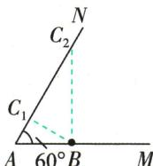

> [!success]- 必刷题
>
> > [!success] **【答案】** $1<AC<4$
>
> > [!note]- **【解析】**
> > 如图, 过点 B 作 $BC_{1} \perp AM$ 垂足为 $C_{1}, BC_{2} \perp AM$ ，交 AN
> > 于点 $C_{2}$ . 在 Rt $\triangle ABC_{1}$ 中，
> > AB=2, $\angle A=60^{\circ}$ , $\therefore \angle ABC_{1}=30^{\circ}$ , $\therefore AC_{1}=\frac{1}{2}AB=1$ . 在
> >
> > 思路分析
> > 当点 C 在射线 AN 上运动时， $\triangle ABC$ 的形状可能是钝角三角形、直角三角形或锐角三角形。画出相应的图形，根据三角形的变化，构造含 $30^{\circ}$ 角的直角三角形，即可得到 AC 的取值范围。
> >
> > 
> >
> > Rt $\triangle ABC_{2}$ 中, $AB=2$ , $\angle A=60^{\circ}$ , $\therefore \angle AC_{2}B=30^{\circ}$ , $\therefore AC_{2}=2AB=4$ . 当点 $C$ 在 $C_{1}$ 和 $C_{2}$ 之间时, $\triangle ABC$ 是锐角三角形, $\therefore AC$ 的取值范围是 $1<AC<4$ . 故答案为 $1<AC<4$ .
> >
> > 思路分析
> > 设这个三角形的底角的度数为 x，分两种情况：①底角是顶角的 2 倍；
> > - **②**：顶角是底角的 2 倍，再根据三角形的内角和定理求解即可.
