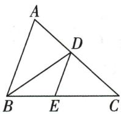
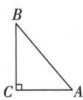

<!-- question-source:start -->
1[2025 湖南娄底期中]如图所示, $BD$ 是 $\triangle ABC$ 的角平分线, 过点 $D$ 作 $DE \parallel AB$ , 交 $BC$ 于点 $E$ , 若 $CE = 4, DE = 3$ , 则边 $BC$ 的长为 ( )
A.6 B.7 C.8 D.9

(第1题图)

(第2题图)
<!-- question-source:end -->

![[Q00104263A1]]
