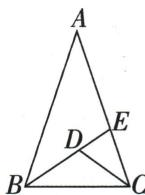

<!-- question-source:start -->
3 如图, 在 $\triangle ABC$ 中, $AB = AC$ , $\angle A = 36^{\circ}$ , $BD$ 平分 $\angle ABC$ 交 $AC$ 于 $E$ , $CD$ 平分 $\angle ACB$ 交 $BE$ 于 $D$ , 图中有 \_\_\_\_ 个等腰三角形.

<!-- question-source:end -->

![[Q00104265A1]]
