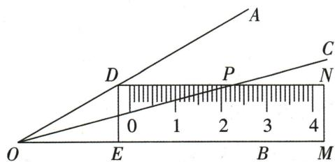

<!-- question-source:start -->
4[2024 湖北黄石校级期中]已知 $\angle AOB$ ，作 $\angle AOB$ 的平分线 OC，将直角尺 DEMN 如图所示摆放，使 EM 与 OB 重合，顶点 D 落在 OA 上，DN 与 OC 交于点 P.

(1)猜想 $\triangle DOP$ 是\_\_\_\_三角形；

(2)请将猜想到的结论进行证明.

<!-- question-source:end -->

![[Q00104266A1]]
