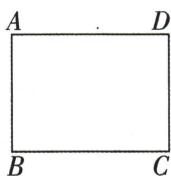
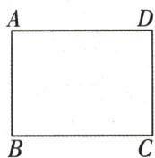
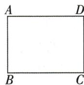
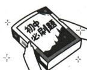

<!-- question-source:start -->
7[2025 浙江杭州质检]如图,在宽和长分别为3 cm 和 4 cm 的长方形 ABCD 中作等腰三角形,其中等腰三角形的两个顶点是长方形的顶点,第三个顶点落在长方形的边上,请画出 3 种满足上述条件的等腰三角形(全等的等腰三角形视为一种),并分别求出所画三角形的面积.

备用图(1)
备用图(2)

公主王子请刷题鸭
<!-- question-source:end -->

![[Q00104269A1]]
