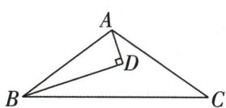
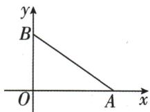

<!-- question-source:start -->
1[2024云南昭通期末,中]如图,在 $\triangle ABC$ 中, $BD$ 平分 $\angle ABC,AD\perp BD,\angle CAD=\angle C$ ,若 $AB=5,AD=2$ ,则 $BC$ 的长为
( )
A.6 B.7 C.8 D.9

(第1题图)

(第2题图)
<!-- question-source:end -->

![[Q00104270A1]]
