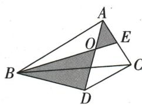

<!-- question-source:start -->
3[2024陕西西安校级期末,中]如图,AC=DC=

3, BD 垂直于 $\angle BAC$ 的平分线 AD, E 为 AC 的中点, 则图中两个阴影三角形 ( $\triangle OBD$ 与 $\triangle OAE$ ) 的面积之差的最大值为 \_\_\_\_.

<!-- question-source:end -->

![[Q00104272A1]]
