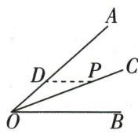
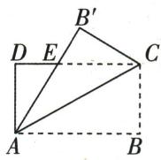
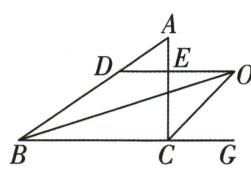
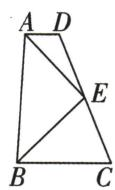

<!-- question-source:start -->
4[2025 浙江宁波校级期末, 中]如图(1), P 为 $\angle AOB$ 的平分线 OC 上一点, 过点 P 作 PD // OB 交 OA 于点 D, 易得 $\triangle POD$ 为等腰三角形. (1)【基本运用】如图(2), 把长方形纸片 ABCD 沿对角线 AC 折叠, 使点 B 落在点 B' 处, $AB'$ 交 CD 于点 E, $\triangle ACE$ 是等腰三角形吗? 为什么?

(2)【类比探究】如图(3)， $\triangle ABC$ 中，内角 $\angle ABC$ 与外角 $\angle ACG$ 的平分线交于点 $O$ ，过点 $O$ 作 $DO / / BC$ 分别交 $AB, AC$ 于点 $D, E$ ，试探究线段 $BD, DE, CE$ 之间的数量关系并说明理由.

(3)【拓展提升】如图(4)，四边形ABCD中， $AD \parallel BC, E$ 为CD边的中点，AE平分 $\angle BAD$ ，连接 BE, 求证: $AE \perp BE$ .

图(2)

图(1)

图(3)
图(4)
<!-- question-source:end -->

![[Q00104273A1]]
