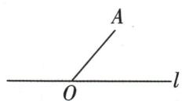
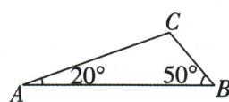
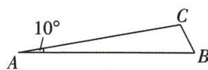

<!-- question-source:start -->
5 思想方法 分类讨论 [2024 广东湛江期末, 较难]
(1) 如图(1), 线段 OA 的一个端点 O 在直线 l 上, 且与直线 l 所成的锐角为 $50^{\circ}$ , 以 OA 为一边画等腰三角形, 并且使另一个顶点 P 在直线 l 上, 这样的等腰三角形能画 \_\_\_\_ 个.
(2) 如图(2), $\triangle ABC$ 中, $\angle A = 20^{\circ}, \angle B = 50^{\circ}$ , 过顶点 C 作一条直线, 把该三角形分割出一个小等腰三角形, 这样的直线最多可以画 \_\_\_\_ 条.
(3) 如图(3), 在 $\triangle ABC$ 中, $\angle BAC = 10^{\circ}$ , 若存在过点 C 的一条直线, 能把该三角形分成两个小等腰三角形, 试求 $\angle B$ 的度数.

图(1)
图(2)

图(3)
<!-- question-source:end -->

![[Q00104274A1]]
