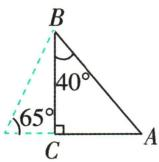
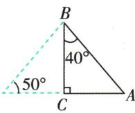
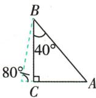
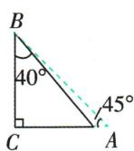
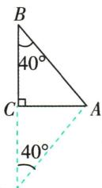
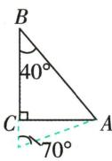
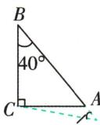

> [!success]- 必刷题
>
> > [!success] **【答案】** C
>
> > [!note]- **【解析】**
> > 如图所示, 这样的三角形共有 7 个, 故选 C.
> >
> > 
> >
> > 
> >
> > 
> >
> > ## 关键点拨
> >
> > 
> >
> > 
> >
> > 
> >
> > 
> >
> > 利用三角形的内角和定理、外角性质及角平分线的定义得到各角的度数,根据等腰三角形的判定得出答案.
> >
> > 3.5 【解析】∵ AB = AC, ∠A = 36°, ∴ △ABC 是等腰三角形, ∴ ∠ACB = ∠ABC = 72°. ∵ BD 平分 ∠ABC 交 AC 于 E, ∴ ∠ABE = ∠EBC = 36°, ∴ ∠A = ∠ABE = 36°, ∴ △ABE 是等腰三角形. ∵ ∠BEC = ∠A + ∠ABE = 72° = ∠ACB, ∴ △BEC 是等腰三角形. ∵ CD 平分 ∠ACB, ∴ ∠DCB = 36°. ∵ ∠DBC = ∠DCB = 36°, ∴ △BCD 是等腰三角形. ∵ ∠EDC = ∠DBC + ∠DCB = 72° = ∠DEC, ∴ △CDE 是等腰三角形, ∴ 共有 5 个等腰三角形.
