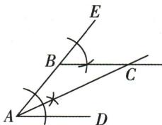

> [!success]- 必刷题
>
> > [!success] **【答案】** C
>
> > [!note]- **【解析】**
> > - **①**：根据作图得 $\angle A = \angle C$ , 故 $AB =$
> >
> > BC, 符合题意;
> > - **②**：根据作图得 AB = AC, 不符合题意;
> > - **③**：如图. 根据作图得 AC 平分 $\angle BAD, BC \parallel AD$ ,
> >
> > 
> >
> > $\therefore \angle BAC = \angle CAD, \angle BCA = \angle CAD, \therefore \angle BAC = \angle BCA, \therefore BA = BC,$ 符合题意；
> > - **④**：根据作图得 $CA = CB$ ，不符合题意，故符合题意的有①③，
> >
> > 故选 **C**.
