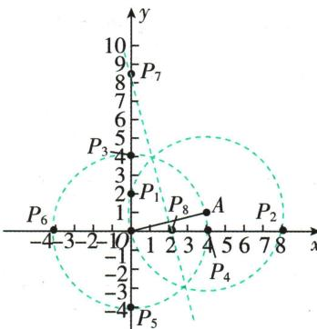
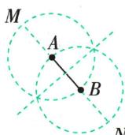

> [!success]- 必刷题
>
> > [!success] **【答案】** C
>
> > [!note]- **【解析】**
> > 如图, ①以 A 为圆心, OA 长为半径作圆, 交坐标轴于 $P_{1}, P_{2}$ 两点 (O 除外);
> >
> > 
> > - **②**：以 O 为圆心，OA 长为半径作圆，交坐标轴于 $P_{3}, P_{4}, P_{5}, P_{6}$ 四点；
> > - **③**：作线段 AO 的垂直平分线，交坐标轴于 $P_{7}$ ， $P_{8}$ 两点，∴ 满足条件的点 P 有 $2+4+2=8$ （个），故选 C.
> >
> > 刷有所得 | 两圆一中垂构造等腰三角形
> > 如图, 已知线段 AB, 在平面内找一点 C, 使得
> > △ABC 为等腰三角形.
> > - **①**：当 AB=AC 时, 点 C 在以点 A 为圆心, AB 长为半径的圆上(不与点 B, M 重合);
> > - **②**：当 AB=BC 时, 点 C 在以点
> >
> > 
> >
> > B 为圆心, AB 长为半径的圆上(不与点 A, N 重合);
> > - **③**：当 AC = BC 时, 点 C 在线段 AB 的垂直平分线上(不在线段 AB 上).
