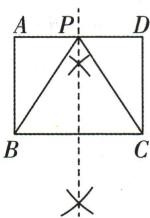
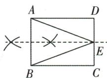
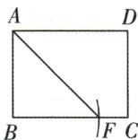

> [!success]- 必刷题
>
> > [!success] **【答案】** 详见解析
>
> > [!note]- **【解析】**
> > 【解】如图(1)，作BC边的垂直平分线，交AD于点P,∴PB=PC,即△PBC为等腰三角形，△PBC的面积为 $\frac{1}{2}\times4\times3=6(cm^{2})$ ;
> > 如图(2)，作AB边的垂直平分线，交CD于点E,∴EA=EB,即△ABE为等腰三角形,△ABE的面积为 $\frac{1}{2}\times3\times4=6(cm^{2})$ ;
> >
> > 
> > 图(1)
> >
> > 
> > 图(2)
> >
> > 
> > 图(3)
> >
> > 如图(3)，以点 B 为圆心，BA 长为半径画弧，交 BC 于点 F，∴ BA = BF，即 $\triangle ABF$ 为等腰三角形， $\triangle ABF$ 的面积为 $\frac{1}{2} \times 3 \times 3 = 4.5 \, (\text{cm}^2)$ .
> > (答案不唯一)
