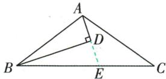

> [!success]- 必刷题
>
> > [!success] **【答案】** D
>
> > [!note]- **【解析】**
> > 延长AD交BC于点E,如图.∵BD平分∠ABC,AD⊥BD,
> > ∴ ∠ABD = ∠EBD,
> > ∠ADB = ∠EDB =
> > 90°. 又∵ BD=BD, ∴ △ABD≌△EBD(ASA),
> > ∴ BE=BA=5, AD=ED=2, ∴ AE=4. ∵ ∠CAD=
> > ∠C, ∴ EC=EA=4, ∴ BC=BE+EC=9. 故选D.
> >
> > 
> >
> > 方法技巧
> > 由角平分线与高重合构造等腰三角形是常用的作辅助线的方法.
