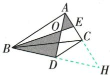

> [!success]- 必刷题
>
> > [!success] **【答案】** B
>
> > [!note]- **【解析】**
> > ∵ $A(4,0)$ , $B(0,3)$ ，且 AB=5，当点 D 坐标为 $(-3,0)$ 时，只能作以 PD, PA 为腰的等腰三角形；当点 D 坐标为 $(-1,0)$ 时，可以作以 PD, PA 为腰的等腰三角形，也可以作以 AP, AD 为腰的等腰三角形；当点 D 坐标为 $(5,0)$ 时，只能作以 AD, PA 为腰的等腰三角形；当点 D 坐标为 $(9,0)$ 时，只能作以 AD, PA 为腰的等腰三角形。故选 B.
> >
> > $$
> > \begin{array}{c} \frac {9}{2} \end{array}
> > $$
> >
> > $$
> > B D, A C
> > $$
> >
> > $$
> > H. \because A D \perp
> > $$
> >
> > $$
> > B H, \therefore \angle A D B = \angle A D H =
> > $$
> >
> > 
> >
> > ## 关键点拨
> >
> > 证明两个阴影三角形的面积之差 $= S_{\triangle ACD}$ 再根据 $DC \perp AC$ 时， $\triangle ACD$ 的面积最大求解.
> >
> > $90^{\circ}, \therefore \angle ABD + \angle BAD = 90^{\circ}, \angle H + \angle HAD = 90^{\circ}.\because AD$ 是 $\angle BAC$ 的平分线, $\therefore \angle BAD = \angle HAD, \therefore \angle ABD = \angle H, \therefore AB = AH.\because AD \perp BH, \therefore BD = DH.\because DC = CA, \therefore \angle CDA = \angle CAD.\because \angle CAD + \angle H = 90^{\circ}, \angle CDA + \angle CDH = 90^{\circ}, \therefore \angle CDH = \angle H,\therefore CD = CH = AC.\because AE = EC, \therefore S_{\triangle ABE} = \frac{1}{4} S_{\triangle ABH}, S_{\triangle CDH} = \frac{1}{4} S_{\triangle ABH},$ $\therefore S_{\triangle ABE} = S_{\triangle CDH}.\because S_{\triangle OBD} - S_{\triangle AOE} = S_{\triangle ADB} - S_{\triangle ABE} = S_{\triangle ADH} - S_{\triangle CDH} = S_{\triangle ACD}.\because AC = CD = 3,\therefore$ 当 $DC \perp AC$ 时, $\triangle ACD$ 的面积最大, 最大面积为 $\frac{1}{2} \times 3\times 3 = \frac{9}{2}$ . 故答案为 $\frac{9}{2}$ .
