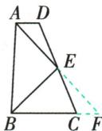

> [!success]- 必刷题
>
> > [!success] **【答案】** 详见解析
>
> > [!note]- **【解析】**
> > (1)【解】 $\triangle ACE$ 是等腰三角形. 理由: 在长方形 $ABCD$ 中, $\because DC \parallel AB, \therefore \angle ACD = \angle BAC$ . 由折叠的性质可得 $\angle BAC = \angle B'AC, \therefore \angle ACD = \angle B'AC, \therefore AE = CE, \therefore \triangle ACE$ 是等腰三角形.
> > (2)【解】 $BD = DE + CE$ . 理由: 同 (1) 可证 $\triangle BDO$ 为等腰三角形, 则 $BD = OD$ . $\because CO$ 平分 $\angle ACG, DO \parallel BC, \therefore \angle OCG = \angle ECO = \angle EOC, \therefore CE = OE, \therefore BD = DO = DE + EO = DE + CE$ .
> >
> > (3)【证明】如图,延长AE交BC的延长线于F.∵AD∥BC,
> > ∴∠F=∠DAE,∠D=∠ECF.
> > ∵AE平分∠BAD,∴∠BAF=
> > ∠DAF,∴∠BAF=∠F,∴BA=BF.∵E是CD的中点,∴DE=CE.在△ADE和△FCE中, $\left\{\begin{aligned}\angle DAE&=\angle CFE,\\\angle ADE&=\angle FCE,\therefore\triangle ADE&\cong\triangle FCE(AAS),\\DE&=CE,\end{aligned}\right.$ ∴ AE = EF, ∴ 点 E 是 AF 的中点, ∴ BE ⊥ AE.
> >
> > 
> >
> > ## 刷素养·
