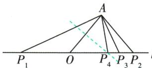
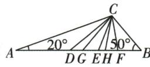
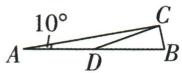
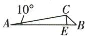
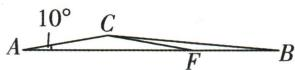

> [!success]- 必刷题
>
> > [!success] **【答案】** 4
>
> > [!note]- **【解析】**
> > 【解】(1)如图(1)，① $AO=OP_{1}$ ，② $AO=AP_{2}$ ，③ $AO=OP_{3}$ ，④ $AP_{4}=OP_{4}$ ，故这样的等腰三角形能画4个.故答案为4.
> >
> > 
> > 图(1)
> >
> > 
> > 图(2)
> >
> > (2)如图(2)，①AC=AF，②BC=BE，③CB=CG，④AD=CD，⑤BH=HC，故过顶点C作一条直线，把该三角形分割出一个小等腰三角形，这样的直线最多可以画5条.故答案为5.(3)如图(3)，当AD=CD时， $\angle ACD=\angle A=10^{\circ}$ ，∴ $\angle CDB=20^{\circ}$ ，∴①当CD=BD时， $\angle B=\angle BCD=80^{\circ}$ ；
> > - **②**：当CD=BC时， $\angle B=\angle CDB=20^{\circ}$ ；
> > - **③**：当BD=BC时， $\angle B=180^{\circ}-20^{\circ}-20^{\circ}=140^{\circ}$ .如图(4)，当AC=AE,CE=BE时，∵ $\angle A=10^{\circ}$ ，∴ $\angle ACE=\angle AEC=85^{\circ}$ ，∴ $\angle B=\angle BCE=42.5^{\circ}$ .如图(5)，当AC=CF,CF=BF时，∵ $\angle A=10^{\circ}$ ，∴ $\angle AFC=\angle A=10^{\circ}$ ，∴ $\angle B=5^{\circ}$ .综上所述， $\angle B$ 的度数为80°或20°或140°或42.5°或5°.
> >
> > 
> >
> > 
> > 图(4)
> >
> > 图(3)
> > 
> > 图(5)
> >
> > ## 15.3.2 等边三角形
> >
> > ## 课时1 等边三角形的性质与判定
