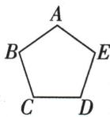

<!-- question-source:start -->
3[2024 福建莆田期末]如图, 将正五边形 ABCDE 置于平面直角坐标系中, 若顶点 A, B, C, D 的坐标分别是

$(0,a),(-2,-1),(c,m),(d,m)$ ，则点 $E$ 的坐标是 （）A. $(2, - 1)$ B.(2,1)C. $(-1, - 2)$ D. $(-2,1)$
<!-- question-source:end -->

![[Q00104245A1]]
