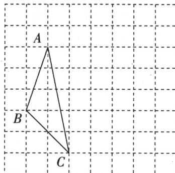

<!-- question-source:start -->
6[2025 安徽淮北期末]如图, 图中的小方格都是边长为 1 的正方形, $\triangle ABC$ 在方格纸中的位置如图所示, 已知点 $A(-2,2), B(-3,-1)$ . (1) 请在方格纸中建立平面直角坐标系, 并写出点 $C$ 的坐标; (2) 在 (1) 的条件下, 作出 $\triangle ABC$ 关于 $y$ 轴对称的 $\triangle A'B'C'$ .

<!-- question-source:end -->

![[Q00104248A1]]
