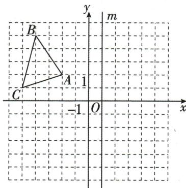

<!-- question-source:start -->
7 如图, 已知 $\triangle ABC$ 的顶点分别为 $A(-2, 2)$ , $B(-4, 5)$ , $C(-5, 1)$ , 直线 $m$ 上各点的横坐标都为 1.

(1) 作出 $\triangle ABC$ 关于 $x$ 轴对称的 $\triangle A_{1}B_{1}C_{1}$ , 并写出点 $B_{1}$ 的坐标;

(2) 作出 $\triangle ABC$ 关于 $y$ 轴对称的 $\triangle A_{2}B_{2}C_{2}$ , 并写出点 $B_{2}$ 的坐标;

(3) 若点 $P(a, b)$ 是 $\triangle ABC$ 内部一点, 则点 $P$ 关于直线 $m$ 对称的点的坐标是 \_\_\_\_.

<!-- question-source:end -->

![[Q00104249A1]]
