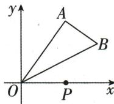

<!-- question-source:start -->
1[2024 广东广州期末, 中]如图, 在平面直角坐标系 $xOy$ 中, 点 $P$ 在 $x$ 轴正半轴上, $\angle A = 90^{\circ}$ , $OA = 2$ , $OB$ 平分 $\angle AOP$ , 则点

$B(a - 1,a - 2)$ 关于 $x$ 轴对称的点的坐标是（）A. $(-2,1)$ B.(3,-2)C.(2,-1) D.(3,-1)
<!-- question-source:end -->

![[Q00104250A1]]
