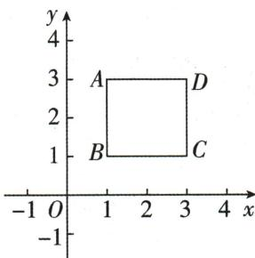

<!-- question-source:start -->
2[2025 山西大同期中, 中]如图, 正方形 ABCD 的顶点 A 的坐标为 $(1,3)$ , AB // y 轴且 AB = 2, 规定把正方形 ABCD 先沿 x 轴翻折, 再向左平移 1 个单位长度为 1 次变换, 则连续经过 2024 次变换后, 正方形 ABCD 的顶点 B 的对应点的坐标为 ( )

A. $(-2023, - 1)$ B. $(-2023,1)$ C. $(-2024, - 1)$ D. $(-2024,1)$
<!-- question-source:end -->

![[Q00104251A1]]
