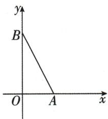

<!-- question-source:start -->
3[2025 河北保定期中, 中]如图, 在平面直角坐标系中, 点 $A(1,0), B(0,2)$ , 作 $\triangle BOC$ (C 不与 A 重合), 使 $\triangle BOC$ 与 $\triangle ABO$ 全等, 则点 C 的横坐标为 \_\_\_\_, 其中与 $\triangle ABO$ 成轴对称的 $\triangle BOC$ 有 \_\_\_\_ 个.

2刷素养▶走向重高
<!-- question-source:end -->

![[Q00104252A1]]
