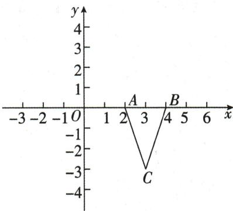

<!-- question-source:start -->
4 核心素养几何直观 [2024 北京西城区期中, 难] 在平面直角坐标系 $xOy$ 中, 已知点 $M(a, b)$ , 我们将经过点 $(a, 0)$ 且垂直于 $x$ 轴的直线记为直线x=a,将经过点(0,b)且垂直于y轴的直线记为直线y=b.
对于点P给出如下定义:将点P关于直线x=a对称得到点 $P'$ ，再将点 $P'$ 关于直线y=b对称得到点Q，称点Q为点P关于M的“对应点”.
对于图形G给出如下定义:将图形G关于直线x=a对称得到图形 $G'$ ，再将图形 $G'$ 关于直线y=b对称得到图形W，称图形W为图形G关于M的“对应图形”.
如图,已知△ABC的顶点坐标为A(2,0),B(4,0),C(3,-3).
(1)若点M(1,1).
①由定义知,将点A关于直线x=1对称得到点(0,0),再将点(0,0)关于直线y=1对称得到点(0,2),则点A关于M的对应点为点(0,2).
那么,点B(4,0)关于M的对应点为点\_\_\_\_,点C关于M的对应点为点\_\_\_\_.
②已知点 $P_{1}(-1,n)$ 和点 $P_{2}(-1,n+1)$ ,若线段 $P_{1}P_{2}$ 关于M的对应线段 $Q_{1}Q_{2}$ 位于△ABC的内部(不含三角形的边),求n的取值范围.
(2)若y轴上存在点D,使得点D关于M的对应点恰好落在△ABC的边上,直接写出M点横坐标a的取值范围.

<!-- question-source:end -->

![[Q00104253A1]]
