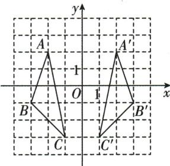
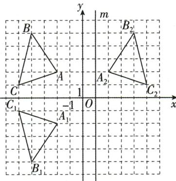

> [!success]- 必刷题
>
> > [!success] **【答案】** 详见解析
>
> > [!note]- **【解析】**
> > 【解】(1)如图,平面直角坐标系xOy即为所求,C(-1,-3).
> >
> > (2)如图, $\triangle A^{\prime}B^{\prime}C^{\prime}$ 即为所求.
> >
> > 
> >
> > $$
> > \triangle A _ {1} B _ {1} C _ {1}
> > $$
> >
> > $$
> > B _ {1}
> > $$
> >
> > $$
> > (- 4, - 5)
> > $$
> >
> > (2)【解】如图所示, $\triangle A_{2}B_{2}C_{2}$ 即为所作,点 $B_{2}$ 的坐标为(4,5).
> >
> > 
> >
> > (3) $(2-a,b)$ 【解析】∵点 $P(a,b)$ 是△ABC 内部一点,∴设点P关于直线m对称的点 $P'$ 的横坐标为x,则 $\frac{a+x}{2}=1$ ,故x=2-a,∴点P关于直线m对称的点的坐标是 $(2-a,b)$ .
> >
> > 关键点按
> > 解答本题的关键是要明确点B对应点的坐标规律:第n次变换后,当n为奇数时点B对应点的坐标为 $(1-n,-1)$ ,当n为偶数时点B对应点的坐标为 $(1-n,1)$ .
