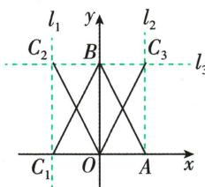

> [!success]- 必刷题
>
> > [!success] **【答案】** -1 或 1, 2
>
> > [!note]- **【解析】**
> > 如图，在 $x$ 轴负半轴上取点 $C_1$ ，使 $OC_{1} = OA$ ，作 $l_{1}\bot$ $x$ 轴于点 $C_1,l_2\bot x$ 轴于点 $A,l_3\bot y$ 轴于点 $B$ ，分
> >
> > 
> >
> > 别交 $l_{1}, l_{2}$ 于点 $C_{2}, C_{3}$ , 易得 $\triangle ABO \cong \triangle C_{1}BO \cong \triangle C_{2}OB \cong \triangle C_{3}OB$ . 因为 $A(1,0)$ , 所以 $OC_{1} = BC_{2} = BC_{3} = OA = 1$ , 所以 $C_{1}(-1,0)$ . 因为 $\angle OBC_{2} = \angle OBC_{3} = 90^{\circ}, B(0,2)$ , 所以 $C_{2}(-1,2), C_{3}(1,2)$ , 所以点 $C$ 的横坐标为 -1 或 1. 因为 $C_{1}(-1,0)$ 与 $A(1,0)$ 关于 $y$ 轴对称, $B(0,2), C_{3}(1,2)$ 分别与 $O(0,0), A(1,0)$ 关于直线 $y = 1$ 对称, 所以 $\triangle C_{1}BO$ 与 $\triangle ABO$ 关于 $y$ 轴对称, $\triangle C_{3}OB$ 与 $\triangle ABO$ 关于直线 $y = 1$ 对称, 所以与 $\triangle ABO$ 成轴对称的 $\triangle BOC$ 有 2 个. 故答案为 -1 或 1, 2.
> >
> > ## 刷素养·
