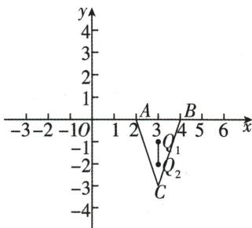

> [!success]- 必刷题
>
> > [!success] **【答案】** $(-2,2), (-1,5)$
>
> > [!note]- **【解析】**
> > 【解】(1)①将点 $B(4,0)$ 关于直线 $x = 1$ 对称得到点 $(-2,0)$ , 再将点 $(-2,0)$ 关于直线 $y = 1$ 对称得到点 $(-2,2)$ , 则点 $B(4,0)$ 关于 $M$ 的对应点为点 $(-2,2)$ . 将点 $C(3,-3)$ 关于直线 $x = 1$ 对称得到点 $(-1,-3)$ , 再将点 $(-1,-3)$ 关于直线 $y = 1$ 对称得到点 $(-1,5)$ , 则点 $C(3,-3)$ 关于 $M$ 的对应点为点 $(-1,5)$ , 故答案为 $(-2,2), (-1,5)$ . ②点 $P_{1}(-1,n)$ 关于 $M$ 的对应点为 $Q_{1}(3,2-n)$ , 点 $P_{2}(-1,n+1)$ 关于 $M$ 的对应点为 $Q_{2}(3,1-n)$ . 如图, 若线段 $Q_{1}Q_{2}$ 在 $\triangle ABC$ 内部, 则只需 $Q_{1}$ 在 $x$ 轴下方, $Q_{2}$ 在 $C(3,-3)$ 上方, $\therefore \left\{ \begin{array}{l} 2 - n < 0, \\ 1 - n > -3, \end{array} \right.$ 解得 $2 < n < 4$ .
> >
> > 
> >
> > (2) $1 \leqslant a \leqslant 2$ . 设点 $D(0, d)$ . $\because M(a, b)$ , $\therefore$ 点 D 关于 M 的对应点为 $D'(2a, 2b - d)$ . $\because$ 点 D 关于 M 的对应点恰好落在 $\triangle ABC$ 的边上, $\therefore 2 \leqslant 2a \leqslant 4$ , $\therefore 1 \leqslant a \leqslant 2$ .
> >
> > ## 15.3 等腰三角形
> >
> > ## 15.3.1 等腰三角形
