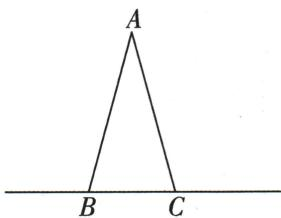

<!-- question-source:start -->
6[2025 陕西西安期中, 中]如图, 在 $\triangle ABC$ 中, $\angle ABC = 75^{\circ}, \angle BAC = 30^{\circ}$ . 点 $P$ 为直线 $BC$ 上一动点, 若以点 $P$ 与 $\triangle ABC$ 三个顶点中的两个顶点为顶点的三角形是等腰三角形, 那么满足条件的点 $P$ 的位置有 ( )

A. 4 个 B. 6 个 C. 8 个 D. 9 个
<!-- question-source:end -->

![[Q00104300A1]]
