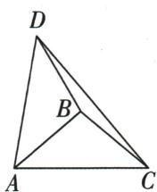

<!-- question-source:start -->
7 [较难] 如图, 在 $\triangle ABC$ 中, $AB = BC$ , $\angle ABC = 100^{\circ}$ , 边 $BA$ 绕点 $B$ 顺时针旋转 $m^{\circ}$ (0 < m < 180) 得到线段 $BD$ , 连接 $AD, DC$ . 若 $\triangle ADC$ 为等腰三角形, 则 $m$ 所有可能的取值是 \_\_\_\_.

<!-- question-source:end -->

![[Q00104301A1]]
