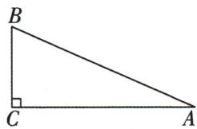
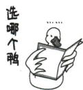

<!-- question-source:start -->
8[2025 贵州贵阳期末, 中]如图, 在 Rt△ABC 中 (AB > 2BC), ∠C = 90°, 以 BC 为边作等腰 △BCD, 使点 D 落在 △ABC 的边上, 则点 D 的位置有 ( )

A. 2 个 B. 3 个 C. 4 个 D. 5 个
<!-- question-source:end -->

![[Q00104302A1]]
