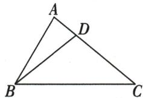

<!-- question-source:start -->
9[中]如图,有一个三角形纸片 ABC, BC 为最长边, $\angle A=80^{\circ}$ , 点 D 是 AC 边上一点, 沿 BD 方向将三角形纸片剪开后, 发现所得两纸片均为等腰三角形, 则 $\angle C$ 的度数可以是 \_\_\_\_.

建议用时 35 分钟 答案 D48

难关
<!-- question-source:end -->

![[Q00104303A1]]
