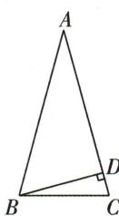

> [!success]- 必刷题
>
> > [!success] **【答案】** C
>
> > [!note]- **【解析】**
> > 由题意得在等腰 $\triangle ABC$ 中, $AB = AC$ , $BD$ 为腰 $AC$ 上的高, $\angle ABD = 60^{\circ}$ . 当 $BD$ 在 $\triangle ABC$ 内部时, 如图(1). $\because BD \perp AC$ , $\therefore \angle ADB = 90^{\circ}$ , $\therefore \angle BAD = 90^{\circ} - 60^{\circ} = 30^{\circ}$ . $\because AB = AC$ ,
> >
> > 
> > 图(1)
> >
> > $\therefore \angle ABC = \angle ACB = \frac{1}{2} (180^{\circ} - 30^{\circ}) = 75^{\circ}$ . 当 $BD$ 在 $\triangle ABC$ 外部时, 如图(2). $\because BD \perp AC$ ,
> >
> > $$
> > \therefore \angle A D B = 9 0 ^ {\circ}, \therefore \angle B A D =
> > $$
> >
> > $$
