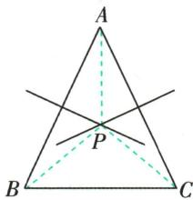
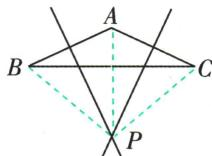

> [!success]- 必刷题
>
> > [!success] **【答案】** C
>
> > [!note]- **【解析】**
> > 分两种情况: 当点 P 在 $\triangle ABC$ 内
> >
> > 部时, 如图(1), 连接 $AP$ , $BP, PC$ . 因为 $AB$ 和 $AC$ 的垂直平分线交于点 $P$ , 所以 $PA = PB = PC$ , 所以 $\angle BAP = \angle ABP, \angle PBC = \angle PCB, \angle PAC = \angle ACP$ . 因
> >
> > 
> > 图(1)
> >
> > 注意分两种情况讨论: ① 当 BD 在 $\triangle ABC$ 内部时;
> > - **②**：当 BD 在 $\triangle ABC$ 外部时.
> >
> > 为 $\angle BPC=100^{\circ}$ , 所以 $\angle PBC+\angle PCB=180^{\circ}-\angle BPC=80^{\circ}$ . 因为 $\angle BAC+\angle ABC+\angle ACB=180^{\circ}$ , 所以 $\angle ABP+\angle BAP+\angle ACP+\angle CAP=180^{\circ}-(\angle PBC+\angle PCB)=100^{\circ}$ , 所以 $2\angle BAP+2\angle CAP=100^{\circ}$ , 所以 $\angle BAP+\angle CAP=50^{\circ}$ , 所
> >
> > 以 $\angle BAC = 50^{\circ}$ 当点 $P$ 在 $\triangle ABC$ 外部时，如图(2)，连接 $AP,BP,PC.$ 因为 $AB$ 和 $AC$ 的垂直平分线交于点 $P$ ，所以 $PA = PB = PC$ ，所
> >
> > 
> > 图(2)
> >
> > 以 $\angle BAP = \angle ABP, \angle PAC = \angle ACP.$ 因为 $\angle BPC = 100^{\circ}$ , 所以 $\angle ABP + \angle BAP + \angle CAP + \angle ACP = 360^{\circ} - \angle BPC = 260^{\circ}$ , 所以 $2\angle BAP + 2\angle CAP = 260^{\circ}$ , 所以 $\angle BAP + \angle CAP = 130^{\circ}$ , 所以 $\angle BAC = 130^{\circ}$ . 综上所述, 等腰三角形的顶角为 $50^{\circ}$ 或 $130^{\circ}$ .
> >
> > 故选 **C**.
