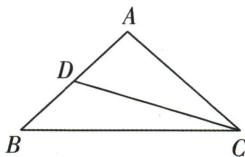

> [!success]- 必刷题
>
> > [!success] **【答案】** 15
>
> > [!note]- **【解析】**
> > 如图, 设等腰 $\triangle ABC$ 的腰长是 $AB = AC = x \mathrm{~cm}$ . 当 $AD + AC - (BD + BC) = 5$ 时, $\frac{1}{2} x + x - \left(\frac{1}{2} x + 10\right) = 5$ ,
> >
> > 
> >
> > 解得 x=15. 长为 15,15,10 的线段能够组成三角形. 当 $BC+BD-(AD+AC)=5$ 时, $10+\frac{1}{2}x-\left(\frac{1}{2}x+x\right)=5$ , 解得 x=5. 长为 5,5,10 的线段不能组成三角形. 故这个三角形的腰长为 15 cm. 故答案为 15.
> >
> > ## ▶ 易错警示
> >
> > 设等腰三角形的腰长是x cm, 根据周长的其中一部分比另一部分长5 cm列方程求解即可, 注意分类讨论, 不要漏解.
