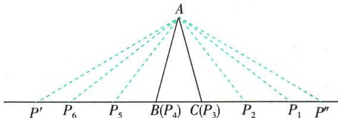

> [!success]- 必刷题
>
> > [!success] **【答案】** C
>
> > [!note]- **【解析】**
> > ∵ 在 $\triangle ABC$ 中， $\angle ABC = 75^{\circ}$ ， $\angle BAC = 30^{\circ}$ ，∴ $\angle ACB = 180^{\circ} - \angle ABC - \angle BAC = 180^{\circ} - 75^{\circ} - 30^{\circ} = 75^{\circ}$ 。如图，当 $\angle CAP_{1} = \angle CP_{1}A = \frac{1}{2} \times 75^{\circ} = 37.5^{\circ}$ 时， $\triangle CAP_{1}$ 为等腰三角形。当 $\angle BAP_{2} = \angle BP_{2}A = \frac{1}{2} \times (180^{\circ} - 75^{\circ}) = 52.5^{\circ}$ 时， $\triangle BAP_{2}$ 为等腰三角形。当 $\angle P''AB = \angle P''BA = 75^{\circ}$ 时， $\triangle P''AB$ 为等腰三角形。当 $P_{3}$ 与 C 重合时， $\triangle ABP_{3}$ 为等腰三角形。当 $P_{4}$ 与 B 重合时， $\triangle ACP_{4}$ 为等腰三角形。当 $\angle P'AC = \angle P'CA = 75^{\circ}$ 时， $\triangle P'AC$ 为等腰三角形。当 $\angle CAP_{5} = \angle CP_{5}A = \frac{1}{2} \times (180^{\circ} - 75^{\circ}) = 52.5^{\circ}$ 时， $\triangle CAP_{5}$ 为等腰三角形。当 $\angle BAP_{6} = \angle BP_{6}A = \frac{1}{2} \times 75^{\circ} = 37.5^{\circ}$ 时， $\triangle BAP_{6}$ 为等腰三角形。综上，满足条件的点 P 的位置有 8 个。故选 C。
> >
> > 
