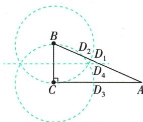

> [!success]- 必刷题
>
> > [!success] **【答案】** C
>
> > [!note]- **【解析】**
> > 如图,①以 BC 为腰时,以 B 为圆
> >
> > 心、BC 长为半径画圆，与 AB 有一个交点 $D_{1}$ ；以 C 为圆心、BC 长为半径画圆，与 AB 有一个交点，与 AC 有一个交点，
> >
> > 
> >
> > 分别为 $D_{2}, D_{3}$ . ②以 BC 为底时, 作 BC 的垂直平分线,与 AB 有一个交点 $D_{4}$ . 综上可知, 点 D 的位置有 4 个,
> >
> > 故选 **C**.
