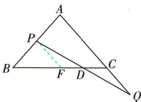

> [!success]- 必刷题
>
> > [!success] **【答案】** $25^{\circ}$ 或 $40^{\circ}
>
> > [!note]- **【解析】**
> > 由题意知 $\triangle ABD$ 与 $\triangle DBC$ 均为等腰三角形, 对于 $\triangle ABD$ 可能有① AB = BD, 此时 $\angle ADB = \angle A = 80^{\circ}, \therefore \angle BDC = 180^{\circ} - \angle ADB = 180^{\circ} - 80^{\circ} = 100^{\circ}, \therefore \angle C = \frac{1}{2}(180^{\circ} - 100^{\circ}) = 40^{\circ};$ ② AB = AD, 此时 $\angle ADB = \frac{1}{2}(180^{\circ} - \angle A) = \frac{1}{2}(180^{\circ} - 80^{\circ}) = 50^{\circ},$ ∴ $\angle BDC = 180^{\circ} - \angle ADB = 180^{\circ} - 50^{\circ} = 130^{\circ},$ ∴ $\angle C = \frac{1}{2}(180^{\circ} - 130^{\circ}) = 25^{\circ};$ ③ AD = BD, 此时 $\angle ADB = 180^{\circ} - 2 \times 80^{\circ} = 20^{\circ}, \therefore \angle BDC = 180^{\circ} - \angle ADB = 180^{\circ} - 20^{\circ} = 160^{\circ}, \therefore \angle C = \frac{1}{2}(180^{\circ} - 160^{\circ}) = 10^{\circ}.$ 此时 $\angle ABC = 90^{\circ},$ 则 AC 为最长边, 与 BC 为最长边矛盾, 故舍去. 综上所述, $\angle C$ 的度数可以为 $25^{\circ}$ 或 $40^{\circ}.$ 故答案为 $25^{\circ}$ 或 $40^{\circ}.$
> >
> > 思路分析
> > 分 AB = BD,
> > AB = AD, AD =
> > BD 三种情况讨论, 先求出 $\angle ADB$ , 再求出 $\angle BDC$ , 然后根据等腰三角形的性质列式计算即可.
> >
> > 图(1). 因为点 P 和点 Q 同时出发, 且速度相同, 所以 BP = CQ. 因为 PF // AQ, 所以 $\angle PFB = \angle ACB$ , $\angle DPF = \angle DQC$ . 因为 AB = AC, 所以 $\angle B = \angle ACB$ , 所以 $\angle B = \angle PFB$ , 所以 BP = PF, 所以 PF = CQ. 因为 $\angle PDF = \angle QDC$ , $\angle DPF = \angle DQC$ , PF = CQ, 所以 $\triangle PFD \cong \triangle QCD$ , 所以 PD = QD.
> >
> > 思路分析
> > (1) 过点 P 作 PF//AC 交 BC 于 F，则 $\angle PFB = \angle ACB, \angle DPF = \angle DQC,$ 先证 PF = CQ，进而由 AAS 证得 $\triangle PFD \cong \triangle QCD$ ，根据全等三角形的性质即可得出结论.
> >
> > 
