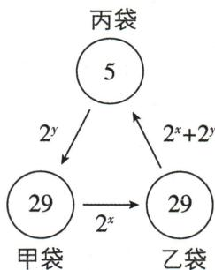

<!-- question-source:start -->
9[2025 河北石家庄期中]如图,在甲、乙、丙三只袋中分别装有球 29 个、29 个、5 个. 先从甲袋中取出 $2^{x}$ 个球放入乙袋,再从乙袋中取出 $(2^{x} + 2^{y})$ 个球放入丙袋,最后从丙袋中取出 $2^{y}$ 个球放入甲袋,此时三只袋中球的个数相同,则 $2^{x+y}$ 的值等于 \_\_\_\_.

2刷易错 小心有坑\~
<!-- question-source:end -->

![[Q00104348A1]]
