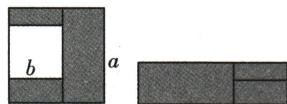

<!-- question-source:start -->
2[2024 湖南衡阳期末]如图,在边长为 a 的正方形中挖掉一个边长为 b 的小正方形 $(a>b)$ , 将余下部分剪拼成一个长方形, 根据两个图形阴影部分面积的关系, 可以得到一个关于 a, b 的恒等式为 ( )

A. $(a + b)(a - b) = a^2 -b^2$ B. $(a + b)^{2} = a^{2} + 2ab + b^{2}$ C. $(a - b)^{2} = a^{2} - 2ab + b^{2}$ D. $a^2 -ab = a(a - b)$
<!-- question-source:end -->

![[Q00104443A1]]
