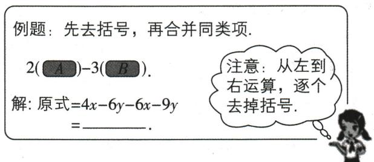

<!-- question-source:start -->
8 如图是一道例题及部分解答过程, 其中 A, B 是两个关于 x, y 的二项式.

例题：先去括号，再合并同类项.

请仔细观察上面的例题及解答过程,完成下列问题:

(1) 直接写出多项式 A 和 B, 并求出该例题的运算结果.

(2) 求多项式 $A$ 与 $B$ 的平方差.
<!-- question-source:end -->

![[Q00104449A1]]
