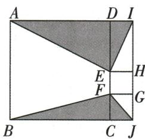

<!-- question-source:start -->
2[2024 广西贵港期末, 中]如图, 点 D, C, H, G 在长方形 ABJI 的边上, 点 E, F 在 CD 上, 若正方形 ABCD 的面积等于 15, 图中阴影部

分的面积总和为 6, 则正方形 EFGH 的面积等于
( )
A. 3 B. 4 C. 5 D. 6

<!-- question-source:end -->

![[Q00104451A1]]
