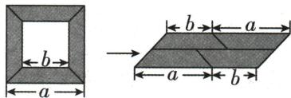
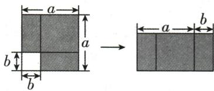
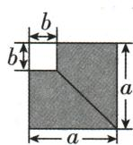
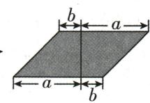
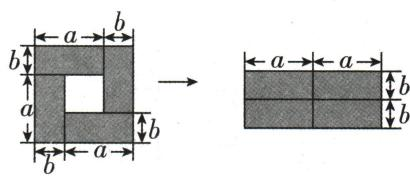

<!-- question-source:start -->
5[2025 吉林长春校级质检, 中]某数学兴趣小组用“等面积法”分别构造了以下四种图形验证“平方差公式”:

①

②

③

④

(1)【探究】以上四种方法中能够验证“平方差公式”的有\_\_\_\_（填序号）.

(2)【应用】利用“平方差公式”计算: $2024^{2}-2023\times2025$ .

(3)【拓展】计算: $(2+1)(2^{2}+1)(2^{4}+1)(2^{8}+1)\times\cdots\times(2^{64}+1)$ .
<!-- question-source:end -->

![[Q00104454A1]]
