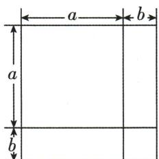
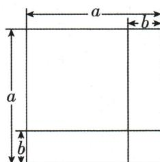
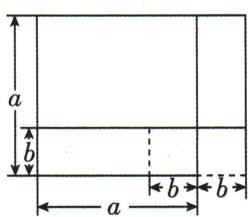
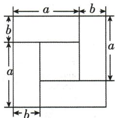

<!-- question-source:start -->
11[2023 四川攀枝花中考]我们可以利用图形中的面积关系来解释很多代数恒等式. 给出以下4组图形及相应的代数恒等式:
① $(a+b)^{2}=a^{2}+2ab+b^{2}$ ② $(a-b)^{2}=a^{2}-2ab+b^{2}$

③ $(a+b)(a-b)=a^{2}-b^{2}$ ④ $(a-b)^{2}=(a+b)^{2}-4ab$

其中,图形的面积关系能正确解释相应的代数恒等式的有 ( )
A. 1 个 B. 2 个 C. 3 个 D. 4 个
<!-- question-source:end -->

![[Q00104791A1]]
