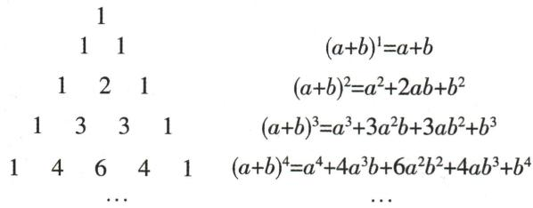

<!-- question-source:start -->
13 1261 年,我国宋朝数学家杨辉在其著作《详解九章算法》中提到了如图所示的数表,人们将这个数表称为“杨辉三角”.

观察“杨辉三角”与右侧的等式图,根据图中各式的规律, $(a+b)^{7}$ 展开的多项式中各项系数之和为\_\_\_\_.
<!-- question-source:end -->

![[Q00105059A1]]
