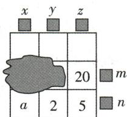
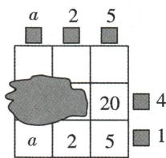
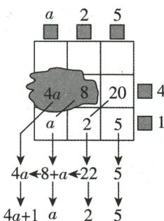

> [!success]- 必刷题
>
> > [!success] **【答案】** D
>
> > [!note]- **【解析】**
> > 设这个三位数与这个两位数分别为 $100x + 10y + z$ 和 $10m + n(x, y, z, m, n$ 均为小于 10 的正整数），如图（1），则由题意得 mz = 20, nz = 5, ny = 2, nx = a, ∴ $\frac{mz}{nz} = 4$ ，则 m = 4n，∴ 当 n = 2, y = 1 时，z = 2.5，不是正整数，不符合题意，故舍去；当 n = 1, y = 2 时，m = 4, z = 5, x = a，如图（2）所示.
> >
> > 
> >
> > 
> > 图(1)
> > 图(2)
> >
> > A 选项，“20”左边的数是 $2 \times 4 = 8$ ，故本选项不符合题意；B 选项，“20”右边的“■”表示 4，故本选项不符合题意；根据题意可得，表格中被墨迹覆盖的数据应为 $4a$ ，8，如图(3)．∴运算结果
> >
> > 
> > 图(3)
> >
> > 可以表示为 $1000(4a+1)+100a+25=4100a+1025$ ，故 D 选项符合题意；当 a=2 时，运算结果大于 6000，故 C 选项不符合题意。
> >
> > 故选 **D**.
