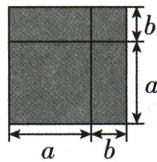
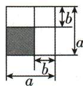
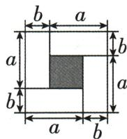
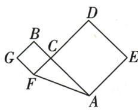

## 全章综合训练 刷章测

![[初中/课堂同步/教辅/必刷题/2026版《初中必刷题》数学 RJ  8上/16_第十六章_整式的乘法/全章综合训练/questions/Q00104792.md]]
![[初中/课堂同步/教辅/必刷题/2026版《初中必刷题》数学 RJ  8上/16_第十六章_整式的乘法/全章综合训练/questions/Q00104793.md]]
![[初中/课堂同步/教辅/必刷题/2026版《初中必刷题》数学 RJ  8上/16_第十六章_整式的乘法/全章综合训练/questions/Q00104794.md]]
![[初中/课堂同步/教辅/必刷题/2026版《初中必刷题》数学 RJ  8上/16_第十六章_整式的乘法/全章综合训练/questions/Q00104795.md]]
![[初中/课堂同步/教辅/必刷题/2026版《初中必刷题》数学 RJ  8上/16_第十六章_整式的乘法/全章综合训练/questions/Q00104796.md]]
![[初中/课堂同步/教辅/必刷题/2026版《初中必刷题》数学 RJ  8上/16_第十六章_整式的乘法/全章综合训练/questions/Q00104797.md]]
![[初中/课堂同步/教辅/必刷题/2026版《初中必刷题》数学 RJ  8上/16_第十六章_整式的乘法/全章综合训练/questions/Q00104798.md]]
![[初中/课堂同步/教辅/必刷题/2026版《初中必刷题》数学 RJ  8上/16_第十六章_整式的乘法/全章综合训练/questions/Q00104799.md]]
![[初中/课堂同步/教辅/必刷题/2026版《初中必刷题》数学 RJ  8上/16_第十六章_整式的乘法/全章综合训练/questions/Q00104800.md]]

## 二、填空题(本大题共4小题,每小题4分,共16分)

![[初中/课堂同步/教辅/必刷题/2026版《初中必刷题》数学 RJ  8上/16_第十六章_整式的乘法/全章综合训练/questions/Q00104801.md]]
![[初中/课堂同步/教辅/必刷题/2026版《初中必刷题》数学 RJ  8上/16_第十六章_整式的乘法/全章综合训练/questions/Q00104802.md]]
![[初中/课堂同步/教辅/必刷题/2026版《初中必刷题》数学 RJ  8上/16_第十六章_整式的乘法/全章综合训练/questions/Q00105058.md]]
![[初中/课堂同步/教辅/必刷题/2026版《初中必刷题》数学 RJ  8上/16_第十六章_整式的乘法/全章综合训练/questions/Q00105059.md]]

## 三、解答题(本大题共4小题,共57分)

![[初中/课堂同步/教辅/必刷题/2026版《初中必刷题》数学 RJ  8上/16_第十六章_整式的乘法/全章综合训练/questions/Q00104804.md]]
![[初中/课堂同步/教辅/必刷题/2026版《初中必刷题》数学 RJ  8上/16_第十六章_整式的乘法/全章综合训练/questions/Q00104805.md]]
![[初中/课堂同步/教辅/必刷题/2026版《初中必刷题》数学 RJ  8上/16_第十六章_整式的乘法/全章综合训练/questions/Q00104806.md]]
![[初中/课堂同步/教辅/必刷题/2026版《初中必刷题》数学 RJ  8上/16_第十六章_整式的乘法/全章综合训练/questions/Q00104807.md]]

## 【拓展探究】

(2)如图(3)，用4个长和宽分别为a,b的长方形拼成一个正方形，请你根据阴影部分的面积，直接写出 $(a+b)^{2},(a-b)^{2}$ ,ab之间的等量关系.

## 【解决问题】

(3)如图(4), C 是线段 AB 上的一点, 分别以 AC, BC 为边向两侧作正方形 ACDE 和正方形 BCFG, 若 AB = 6, 两正方形的面积和为 20, 求 $\triangle AFC$ 的面积.

图(1)

图(2)

图(3)

图(4)
