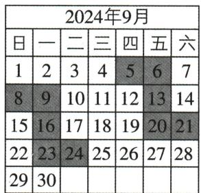
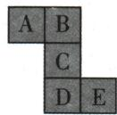

<!-- question-source:start -->
1[2025吉林长春质检]如图(1)是2024年9月份的月历,用“Z”字型框架任意框住月历中的5个数(如图(1)中的阴影部分),如图(2),将“Z”字型框架中位于B、D处的数相乘,位于A、E处的数相乘,得到的两个值再相减,不难发现,结果都等于15,例如:在图(1)中, $9\times23-8\times24=15,6\times20-5\times21=15$ .设位于C处的数为x.

图(1)

图(2)

(1)用含 x 的代数式表示位于 A、B、D、E 处的数: A: \_\_\_\_, B: \_\_\_\_, D: \_\_\_\_, E: \_\_\_\_.

(2)用含 $x$ 的式子表示发现的规律: \_\_\_\_.

(3) 利用整式的运算对(2)中的规律加以证明.

不愧是我鸭
<!-- question-source:end -->

![[Q00104777A1]]
