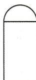

<!-- question-source:start -->
10[2025 山西大同期中]如图是某拱形门示意图,它是由上、下两部分组成的.上面是半圆,半圆的直径为 $x \mathrm{~m}$ ;下面是长方形,宽为 $x \mathrm{~m}$ ,长是宽的 2 倍.这个拱形门的面积可表示为 \_\_\_\_ $\mathrm{m}^{2}$ . (结果保留 $\pi$ )

② 刷易错 ▶ 小心有坑\~
<!-- question-source:end -->

![[Q00104385A1]]
