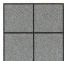
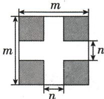

<!-- question-source:start -->
2 将形状大小完全相同的四个小正方形,按照如图所示的两种方式放置于两个边长不相等的大正方形中,根据两个图形中阴影部分的面积关系,得到的等式是 ( )

图(1)

图(2)

A. $(m + n)(m - n) = m^2 -n^2$ B. $(m + n)^{2} = m^{2} + 2mn + n^{2}$ C. $(m + n)^{2} - (m - n)^{2} = 4mn$ D. $(m - n)^{2} = m^{2} - 2mn + n^{2}$
<!-- question-source:end -->

![[Q00104456A1]]
