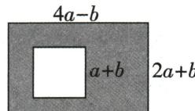

<!-- question-source:start -->
10[2024 山西晋城期中]如图,某校园内有一块长为 $(4a-b)$ 米,宽为 $(2a+b)$ 米的长方形空地,学校计划在中间留一块边长为 $(a+b)$ 米的正方形空地修建一个乒乓球场地,然后将剩余阴影部分进行绿化.
(1)用含 a, b 的代数式表示绿化部分的面积
(结果需化简);

(2) 当 a=5, b=4 时, 求绿化部分的面积.

<!-- question-source:end -->

![[Q00104464A1]]
